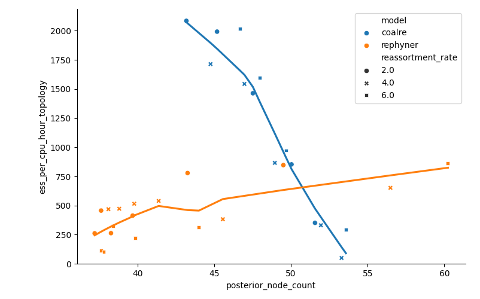

# rephyner

rephyner is a BEAST 2 package for Bayesian inference of reduced ancestral recombination graphs (rARGs). It is a fork of [CoalRe](https://github.com/nicfel/CoalRe) and uses it to simulate full ARGs. The Python code for the learned rARG prior is in `prior_learning/`. This document describes the state on 2026-10-20.

## 1. Introduction

An ancestral recombination graph (ARG) describes the joint genealogy of sequences that exchange genetic material by recombination. rephyner currently handles the segmented case (e.g. reassortment in influenza), where each recombination splits a lineage into two parents, each inheriting a subset of the segments. Each segment $s$ has a local tree $T_s$, and the data of segment $s$ depend on the ARG only through $T_s$.

Bayesian ARG inference samples the full ARG $G$ by MCMC. This is slow, due to the large parameter space and rugged posterior distribution, but also because much of $G$ cannot be identified from the data. The timing of a recombination, coalescences between lineages that share no segments, and recombination "loops" leave all local trees unchanged. The sampler spends effort on these parts and has to change them together with the parts that matter.

The idea of rephyner is to sample the reduced ARG $R = r(G)$ instead. The reduced ARG contains only nodes and edges that appear in at least one local tree. $R$ fully determines the local trees, so the likelihood is unchanged, but many ARGs collapse onto the same $R$. We hope this gives a smaller state space, a smoother posterior, and operators that work directly on local trees. The gain should grow with the number of segments and the amount of recombination.

The price is the prior: the prior on $R$ implied by the full-ARG model (e.g. CoalRe's coalescent with reassortment) is an integral over all ARGs that reduce to $R$, with no known closed form. The project therefore has two fronts: an approximation of this prior (Section 3) and MCMC operators for rARGs (Section 4). The first question is whether the rARG sampler mixes better than CoalRe at all, even with a simple stand-in prior; only then is a good prior approximation worth finishing.

## 2. Reduced ARGs

Notation: $n$ taxa, $m$ segments $\mathcal{S}$, time measured backwards.

### Definition

$R = r(G)$ has as nodes all leaves of $G$ and every node of $G$ that is an internal node of at least one local tree. It has an edge $w \to u$ labelled with the segments $\{s : w \text{ is the parent of } u \text{ in } T_s\}$ whenever this set is not empty, and a root edge at each node that is the root of some local tree (a rARG can have several). Equivalently, $R$ is the union of all local trees, with parallel edges merged.

Recombination events are not nodes of $R$. They only affect $R$ by changing the connectivity of the coalescence nodes. For an internal node $v$ with $c_v$ child edges and $p_v$ parent edges:

* every node is a coalescence: each segment leaving $v$ comes from exactly two child edges and leaves through exactly one parent edge;
* the parent edges partition the segments leaving $v$ (this is where reticulation appears);
* $c_v$ can exceed 2, since different segments can coalesce different pairs of children at the same node;
* nothing is redundant: every edge carries a segment and every node is used by some local tree.

### Reducing ARGs r(G)

`NetworkReducer.reduce()` computes $r(G)$ from a CoalRe `Network` in one pass from the tips to the root, keeping track of which segments of each $R$-node have not yet coalesced. A node of $G$ becomes a node of $R$ if at least one segment arrives on two of its incoming lineages. It is used to initialise the MCMC from a simulated ARG, to log rARG statistics of CoalRe runs, and to generate training data for the learned prior.

### Likelihood

Since $T_s(R) = T_s(G)$, the likelihood is the same product of tree likelihoods as for the full ARG:

$$
p(D \mid R, \theta_D) = \prod_{s=1}^{m} p\big(D_s \mid T_s(R), \theta_D\big).
$$

### Prior

The full-ARG prior implies

$$
p(R \mid \theta) = \int \mathbf{1}\big[r(G) = R\big]\, p(G \mid \theta)\, dG ,
$$

an integral over the recombination events and their times, invisible coalescences, invisible loops, and how the edges of $R$ map to lineages of $G$. This is hard because the hidden part has no bounded size, and because the edges of $R$ do not correspond one-to-one to lineages of $G$: the rate of the next event in $R$ depends on hidden lineages and hence on the whole history of $R$.

A usable replacement should be normalised (ideally with a simulator, so it can be validated), must not depend on recombination times, must be cheap enough to evaluate at every MCMC step, and must be close to the true prior where the posterior has its mass.

## 3. Approaches to the prior

| Approach | Exact? | State |
|---|---|---|
| A. Don't integrate: sample $G$ (CoalRe) | yes | baseline |
| B. Estimate $p(R \mid \theta)$ by importance sampling over the hidden events and use it in pseudo-marginal MCMC | yes | not implemented; expensive |
| C. Hand-crafted density on $R$ with a few parameters, tuned to simulated rARGs | no | `ReducedCoalescent` (used in the simulation study) |
| D. Learned approximation $q_\phi(R)$, fitted to simulated rARGs | approximately | Implemented in Python, but fits poorly  |

Posterior samples obtained with the inexact approaches (C and D) could in principle be reweighted by importance weights based on B, giving an exact method without the cost of B inside the MCMC loop.

### Stand-in prior: `ReducedCoalescent`

A cheap density meant for testing the sampler, not an approximation of the integral. It is built in three steps.

1. Coalescent on the rARG nodes:
   $$
   \log p_1(R) = \sum_{i} -K_i \int_{\Delta_i} \frac{dt}{N_e(t)} + \sum_{v} (c_v - 1) \log \frac{1}{N_e(t_v)}.
   $$
   $K_i$ counts the pairs of edges in interval $i$ that share a segment (only these can coalesce visibly), and a node with $c_v$ children counts as $c_v - 1$ coalescences. With one segment this is Kingman's coalescent.

2. Partition term: each node $v$ adds $\log q_\alpha(\pi_v)$, where $\pi_v$ is the split of $v$'s segments over its parent edges and $q_\alpha$ a Chinese restaurant process probability. This is where reticulation gets a probability: $\alpha$ controls how often segments are split, and $\alpha \to 0$ gives trees.

3. Reticulation penalty: optionally subtract $\lambda \sum_v (p_v - 1)$. The total reticulation $\sum_v (p_v - 1)$ (= #edges − #nodes, 0 for a tree) grows with the node count for a fixed number of taxa. The penalty is ad hoc and only used to pull rephyner's reticulation toward CoalRe's.

There is deliberately no term that depends on recombination times.

Limitations: it is not normalised and has no simulator; its node-count distribution has two modes (tree and strongly reticulate network) between which $\alpha$ only shifts weight; and at high recombination rates it cannot reach CoalRe's node counts or branch lengths (Section 5).

`UniformReducedNetworkPrior` is a simple prior with a matching simulator, used only to validate the sampler.

### Learned prior

Simulate many ARGs with CoalRe, reduce them, and fit a normalised model $q_\phi$ to the resulting rARGs by maximum likelihood. Simulation is cheap, so the fit is limited only by the model. The model generates $R$ node by node, from the youngest to the oldest. The state is the set of open nodes, each with its not-yet-coalesced segments and its age. Each step draws a waiting time and which open nodes pass which segments to the new node:

$$
q_\phi(R) = \prod_i q^{\text{wt}}_\phi(\Delta t_i \mid \text{state}_i)\, q^{\text{top}}_\phi(C_i \mid \text{state}_i).
$$

Parent edges are not modelled explicitly; they follow from which later nodes pick up a node's segments, so recombination is untimed by construction.

Implemented in Python (`../prior_learning/`, details and results in its README):

* waiting times: exponential with a log-linear rate in the per-segment lineage counts (gamma per number of open nodes as baseline);
* topology, pairwise urn (v4): decide which segments coalesce, then let each segment pick a pair of children with probability proportional to node weights that grow when earlier segments chose the same node (so linked segments tend to coalesce together);
* topology, two-lineage model (v5, best): models the two hidden ARG lineages behind each coalescence explicitly.

The Java class `LearnedReducedNetworkPrior` implements an older version and is on hold. Open issues: the model is fitted for one recombination rate, so it cannot be used to estimate $\rho$; samples at different times are not handled yet; and it is so far only checked against summary statistics, not against estimates of the true prior.

## 4. Inference

The MCMC samples $R$ (`ReducedNetwork`) and the usual substitution and clock parameters. The local trees are derived from $R$. $N_e$ and the prior parameters are fixed in all current runs, and no rARG prior has a recombination rate yet.

| Operators | Move |
|---|---|
| `UniformNetworkNodeHeightOperator`, `NetworkScaleOperator` | node heights, no topology change |
| Local-tree operators: `LocalTreeSubtreeSlide`, `LocalTreeWilsonBalding`, `LocalTreeSPR`, targeted variants | move a subtree in one local tree; the rARG adapts with as few changes as possible. The subtree attaches to a new node or joins an existing one (which keeps $R$ less reticulate). With piggybacking, other segments on the same edge can follow the move. Targeted variants prefer attachment points with similar sequences |
| Network-edge operators: `NetworkEdgeSlide`, `NetworkEdgeRangeSlide`, `NetworkEdgeWilsonBalding` (+ targeted) | move a whole rARG edge, i.e. all its segments at once |
| `DivertSingleSegmentOperator` | reattach one segment of an edge to another existing node |

## 5. Current state and preliminary results

All results are preliminary (small grids, few replicates, short chains).

Working: rARG data structure, reduction, initialisation from simulated ARGs, `ReducedCoalescent`, the operators above, and the Snakemake workflows (calibration, simulation study, infB/IE-CoR benchmarks).

Results:

* Validation of the uniform model (`validation/wcss`, 10 taxa, 2 segments, 100 replicates): coverage of the 95 % HPD intervals is 91–100 % for all statistics, so the sampler recovers a known model.
* Calibration of `ReducedCoalescent` against CoalRe (`validation/calibration`): mean node counts can mostly be matched, but not the distribution. The prior's networks are about 30 % too short, and at high recombination rates no $\alpha$ reaches CoalRe's node count. The simulation study therefore compares the methods at matched posterior complexity instead of matched priors.
* infB benchmark (8 segments, about 200 taxa, spring 2026, with an older prior: a plain Kingman coalescent on the rARG nodes, without the shared-segment count and the partition term): rephyner had about 180× lower posterior ESS per hour than CoalRe; neither run converged.
* Simulation study pilot (`validation/simstudy`): data simulated under CoalRe (15 taxa, 8 segments, true $\rho \in \{2, 4, 6\}$, 4 runs per setting) and analysed with both methods over a range of prior settings (rephyner: $\alpha$; CoalRe: assumed recombination rate). Since the stand-in prior does not match CoalRe's, the prior setting largely determines how complex the posterior networks are, so we compare efficiency (ESS per CPU-hour) as a function of the posterior node count rather than per true $\rho$. Main findings:
  * At low complexity CoalRe is more efficient, by about 3× on local-tree topology.
  * rephyner scales much better to complex networks. Its runtime barely changes with network size, and its ESS per CPU-hour increases, whereas CoalRe's runtime grows steeply and its ESS per CPU-hour collapses. Above about 50 posterior nodes rephyner is the more efficient method on both continuous statistics and topology.
  * Few runs reach more than 50 posterior nodes (CoalRe none above 54), so the rule fixed in advance (Go if rephyner reaches at least 2× CoalRe's ESS per CPU-hour on both measures over a contiguous range) cannot be assessed properly yet. That needs runs with both methods at higher complexity.

  Mean over all runs in each node-count range (CoalRe / rephyner; – = no runs):

  | posterior node count | topology ESS / CPU-h | continuous ESS / CPU-h | CPU hours |
  |---|---|---|---|
  | < 40 | – / 329 | – / 696 | – / 2.5 |
  | 40–45 | 1899 / 544 | 1403 / 1280 | 1.1 / 2.6 |
  | 45–50 | 1494 / 615 | 840 / 1194 | 1.7 / 2.8 |
  | > 50 | 376 / 759 | 196 / 1194 | 7.3 / 3.3 |

  

  Local-tree topology ESS per CPU-hour against posterior node count in the pilot, one point per prior setting and true recombination rate, with a trend line per method.
